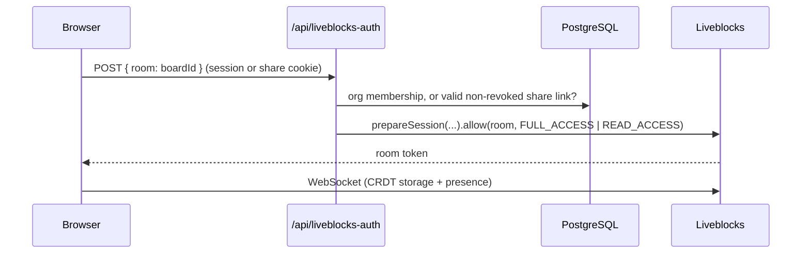

# Synkorum — Real-Time Collaborative Whiteboard

A Miro-style collaborative whiteboard built with Next.js. Multiple users draw, move, and align shapes on a shared canvas in real time, organized around teams with role-based access.

## Screenshots


## Features

### Canvas
- **Shapes:** rectangle, ellipse, diamond, line/arrow, sticky note, text, and freehand pen drawing
- **Real-time multiplayer:** cursors, selections, and live editing powered by Liveblocks (CRDT-based sync) — every shape, move, and edit streams to everyone in the room with no polling or reload
- **Alignment & distribution:** align left/center/right/top/middle/bottom and distribute spacing evenly, for 2+ (align) or 3+ (distribute) selected objects at once, as a single undo step
- **Multi-select resize:** dragging a corner on a multi-object selection scales every selected shape together, proportionally, from its own original size — not just the first one
- **Shift-to-lock aspect ratio** when resizing a single shape (keeps circles circular, squares square)
- **Zoom & pan:** scroll to pan, Ctrl/Cmd+scroll or trackpad pinch to zoom toward the cursor, on-screen zoom controls, and Ctrl/Cmd +/-/0 shortcuts
- **Keyboard shortcuts:** V/R/O/D/L/T/N/P to switch tools, Delete/Backspace to remove, Ctrl/Cmd+D to duplicate, arrow keys to nudge (Shift for 10px steps), Escape to deselect
- **Read-only share links:** share links can grant either full edit access or view-only access to an anonymous guest

### Platform
- **Custom authentication** — email/password auth built from scratch with JWT (`jose`) session tokens in httpOnly cookies and `bcryptjs` password hashing; no third-party auth provider
- **Multi-tenant organizations** — users can belong to multiple teams simultaneously, each with `ADMIN`/`MEMBER` roles and its own set of boards
- **Two invite flows:** email invites that create a full account and org membership, and anonymous share links (editable or read-only) that need no account
- **Favorites, search, and board management** — rename, delete, and organize boards per team
- **Email verification and password reset** flows with time-limited tokens

## Tech Stack

- **Framework:** Next.js 16 (App Router, server actions), React 19
- **Language:** TypeScript
- **Database:** PostgreSQL via Prisma 7 (local development in Docker)
- **Real-time:** Liveblocks (presence, storage, and room-based access control)
- **Auth:** Custom-built — `jose` for JWT, `bcryptjs` for password hashing, httpOnly cookies for sessions
- **Email:** Resend
- **State:** Zustand
- **UI:** Tailwind CSS, shadcn/ui
- **Quality:** Vitest, Playwright, ESLint, GitHub Actions

## Getting Started

Requirements: Node 22+, Docker.

```bash
cp .env.example .env        # then fill in AUTH_SECRET, LIVEBLOCKS_SECRET_KEY, RESEND_API_KEY
npm install
npm run db:up               # starts PostgreSQL in Docker (waits until healthy)
npx prisma generate
npm run db:migrate          # applies the committed migrations (prisma/migrations) to the local database
npm run dev
```

Useful scripts: `npm run db:down` (stop the DB, keep data), `npm run db:reset` (wipe the DB volume and re-apply migrations), `npm run lint`, `npm run typecheck`, `npm test`, `npm run test:e2e` (see [`e2e/README.md`](e2e/README.md) for what it needs).

### Environment variables

| Variable | Required | Purpose |
|---|---|---|
| `DATABASE_URL` | yes | PostgreSQL connection string (matches `docker-compose.yml` locally) |
| `AUTH_SECRET` | yes | Signs session JWTs. Generate with `openssl rand -base64 32`; changing it signs everyone out |
| `LIVEBLOCKS_SECRET_KEY` | yes | Issues room tokens in `/api/liveblocks-auth` |
| `RESEND_API_KEY` | yes | Sends verification, reset, and invite emails |
| `NEXT_PUBLIC_APP_URL` | yes | Public base URL used in emails and share links |
| `EMAIL_FROM` | no | Sender address; defaults to the Resend sandbox sender |
| `TRUSTED_PROXY_COUNT` | no | Number of reverse proxies in front of the app (default `1`), used to find the real client IP for rate limiting |

`.env*` files are git-ignored; only [`.env.example`](.env.example) is committed.

## Architecture

### Access model

Every request is authorized in layers, so no single check is a single point of failure:

1. **`proxy.ts`** verifies the session JWT at the edge, redirects unauthenticated visitors to `/login` (keeping a `callbackUrl`), and bounces logged-in users away from auth pages. Public routes are matched by exact path segment, so `/board` is public but `/boardroom` is not.
2. **Server actions and pages** re-check the session and the caller's role themselves (`requireUser`, `requireOrgMember`, `requireOrgAdmin`). The proxy is a UX layer, not the security boundary.
3. **Liveblocks room access** is decided per request by `/api/liveblocks-auth`, which issues a `FULL_ACCESS` or `READ_ACCESS` room token based on org membership or a share link's own `canEdit` flag — this is the actual enforcement boundary for edit permissions, not the client UI (which only *hides* editing controls for a read-only guest as a courtesy).

### Realtime authorization



Board content (the layer map and z-order list) lives in Liveblocks storage; users, teams, boards metadata, invites, and share links live in PostgreSQL. Share links set a per-board cookie, and guests get an anonymous `guest:<uuid>` identity.

### Data model

`User` ↔ `Membership` (role) ↔ `Organization` → `Board`. `Invite` (email + role + expiry) attaches a new user to an organization at registration. `BoardShareLink` (`canEdit`, expiry, revoked) grants anonymous access to one board. Verification and password-reset tokens are single-purpose, time-limited rows.

### Authentication

- Passwords are hashed with `bcryptjs` (cost 12). New passwords must be 8-72 bytes (bcrypt ignores anything beyond 72 bytes); accounts created under the older, shorter rule can still sign in.
- Sessions are 30-day HS256 JWTs (the algorithm is pinned on verification) in an `httpOnly`, `SameSite=Lax` cookie (`Secure` in production). The user is re-read from the database on every request, and any session issued before `User.passwordChangedAt` is rejected, so a password reset signs out every older session.
- Login returns the same error for an unknown email and a wrong password, and does a dummy password check for unknown emails so response time doesn't reveal which addresses exist. Password reset always returns the same response, whether or not the account exists.
- Unverified accounts cannot sign in; a fresh verification email is sent instead.
- Rate limiting: sign-in is limited per IP and per account, registration, forgot-password, and reset-password per IP, and invitation emails per organization (`429` with `Retry-After` where applicable). The client IP is taken from the entry your own proxy appended to `X-Forwarded-For` (see `TRUSTED_PROXY_COUNT`), not from the client-controlled first entry.
- Expected business errors are thrown as `AppError` and shown to the user as-is. Anything else is logged server-side and replaced with a generic message, so internal errors (for example, a Liveblocks SDK exception or a database connection string) never reach the client as a raw stack trace or an unparsable HTML error page.

## Security

| Threat | Mitigation |
|---|---|
| Broken access control / IDOR | Every server action re-checks membership and role. Destructive operations are scoped to the parent the caller was authorized for (e.g. revoking an invite deletes by `{ id, organizationId }`, revoking a share link updates by `{ id, boardId }`), so an id from another team or board matches nothing. |
| Stored XSS through collaborative content | Board data in Liveblocks is treated as untrusted, because any editor can write to it with the Liveblocks client directly. Text layers always render through an escaping function (`lib/layer-text.ts`) and store plain text only, capped at 1000 characters. |
| Privilege escalation in realtime rooms | Room tokens are issued server-side per request: `FULL_ACCESS` for members and edit links, `READ_ACCESS` for view-only links. The client UI only hides controls as a courtesy. |
| Open redirect after login | `callbackUrl` is accepted only if it is a same-origin path (`lib/safe-redirect.ts`). |
| Clickjacking, content injection, referrer leaks | Security headers on every response: CSP (`frame-ancestors 'none'`, `object-src 'none'`, restricted `connect-src`/`form-action`/`base-uri`), `X-Frame-Options`, `nosniff`, `Referrer-Policy: no-referrer` (tokens travel in query strings), `Permissions-Policy`, and HSTS in production. |
| Credential stuffing / brute force | Per-IP and per-account rate limits, bcrypt cost 12, uniform responses and timing for unknown emails. |
| Session theft | `httpOnly` cookies, 30-day expiry, revocation on password reset. |
| HTML injection in emails | User-controlled values (team names) are escaped before being placed into email HTML. |
| Vulnerable dependencies | Dependabot (npm and GitHub Actions), CodeQL, and `npm audit` for critical production vulnerabilities in CI. Workflows run with read-only permissions and actions are pinned to commit SHAs. |

## Testing and CI

**Unit tests** (Vitest, mocked Prisma client, no real network) cover server actions, permission checks, JWT/password/token helpers, the rate limiter, the auth API routes (login, registration, password reset, Liveblocks room authorization), the route proxy, the canvas geometry functions above (alignment, zoom, group-resize, line endpoints), and the security helpers (output escaping, safe redirects, security headers, session revocation).

**End-to-end tests** (Playwright, in `e2e/`) drive a real browser against a real Postgres database: login/registration through the actual pages, and — the one thing no unit test can prove — two independent browser sessions (an authenticated owner and an anonymous share-link guest) editing the same board and seeing each other's changes live through Liveblocks.

GitHub Actions runs `verify` (dependency audit, lint, typecheck, unit tests) on every push and pull request with no external dependencies, and `e2e` (real Postgres service container + Playwright), which only runs when a `LIVEBLOCKS_SECRET_KEY` repo secret is configured, so it skips cleanly rather than failing on a fork. A separate CodeQL workflow scans the code, and Dependabot proposes dependency updates weekly.

```bash
npm test          # unit tests
npm run test:e2e  # end-to-end (needs a real DB + Liveblocks project, see e2e/README.md)
```

## Deployment checklist

- Use a managed PostgreSQL with strong, unique credentials and TLS (for example `?sslmode=require` in `DATABASE_URL`). The `docker-compose.yml` defaults are for local development only.
- Generate a fresh `AUTH_SECRET` per environment (`openssl rand -base64 32`) and keep it out of the repository.
- Apply migrations with `npx prisma migrate deploy` (not `migrate dev`).
- Set `NEXT_PUBLIC_APP_URL` to the public `https://` URL, and verify your sending domain in Resend and set `EMAIL_FROM`.
- Set `TRUSTED_PROXY_COUNT` to the number of reverse proxies in front of the app.
- Running more than one instance? Replace the in-memory rate limiter first (see Known Limitations).
- After deploying, open a board with the browser console open and check for Content-Security-Policy violations.

## Known Limitations

- The rate limiter keeps its counters in memory, so it works per server instance. For a multi-instance deployment, swap `lib/rate-limit.ts` for a Redis-backed limiter such as Upstash. The per-account sign-in limit also means someone can temporarily lock a known email out by failing attempts on purpose.
- The line/arrow tool always draws an arrowhead at the end; there's no plain-line or no-arrowhead variant yet.
- Alignment is based on each shape's `x`/`y`/`width`/`height` box; for a line that points up-and-right or down-and-left (`flipX`/`flipY`), that box's left edge isn't necessarily the line's visually leftmost point.
- No snapping or connectors between shapes — an arrow doesn't follow a shape it was pointing at if that shape moves.
- A board is capped at 100 layers.
- The CSP still allows inline scripts (`'unsafe-inline'`), because Next.js injects inline bootstrap scripts; a nonce-based policy generated in `proxy.ts` is the next step. Output escaping, not the CSP, is the primary XSS defence today.
- Board content lives in Liveblocks and isn't validated server-side: any editor (including a guest with an edit link) can write arbitrary data to the room, and the 100-layer cap is enforced by the client only. View-only access, however, is enforced by the room token.
- Registration tells the caller when an email is already taken, a deliberate trade-off for clearer sign-up errors that does allow checking whether an address has an account.
- No per-device session list or "sign out everywhere" button; a password reset revokes older sessions.
- Verification, reset, and invite tokens are stored in the database in plaintext (hashing them at rest is a possible hardening).
- No audit log of administrative actions (member removal, role changes, share-link creation).
