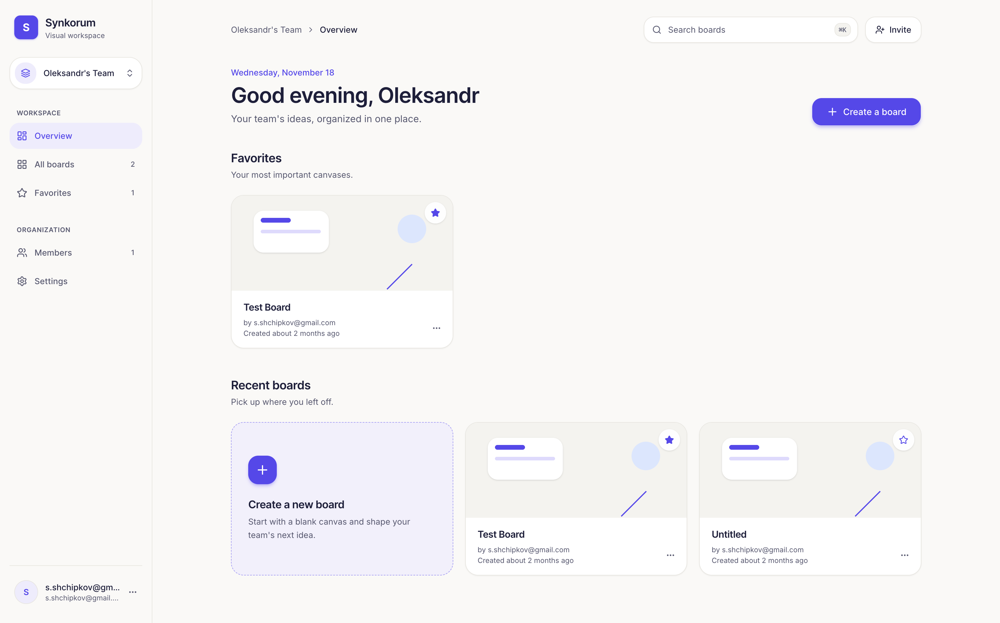
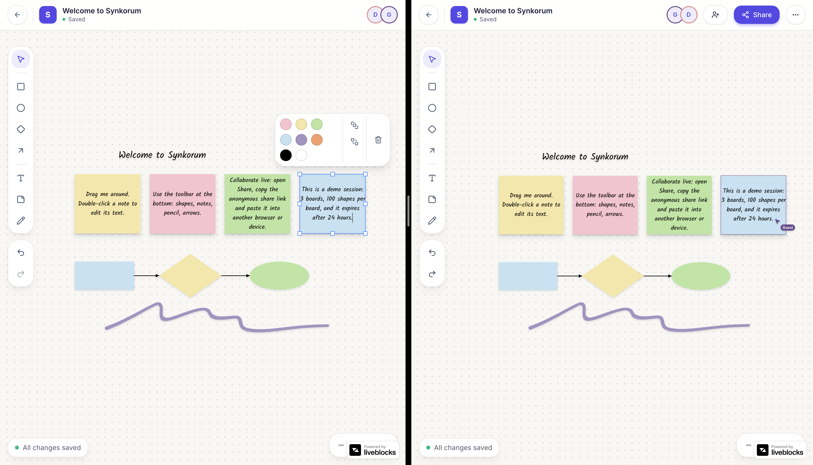

# Synkorum — Real-Time Collaborative Whiteboard

[](https://github.com/sanya-shch/board/actions/workflows/ci.yml)

A Miro-style collaborative whiteboard built with Next.js. Multiple users draw, move, and align shapes on a shared canvas in real time, organized around teams with role-based access.

## Screenshots





## Features

- **Canvas:** shapes, sticky notes, text and freehand drawing, alignment and distribution, multi-select resize, zoom and pan, keyboard shortcuts
- **Real-time multiplayer:** live cursors, selections and edits via Liveblocks (CRDT sync)
- **Teams:** multiple organizations per user with `ADMIN` / `MEMBER` roles, favorites, search
- **Sharing:** email invites, plus anonymous editable or read-only share links
- **Custom auth:** email/password with JWT sessions in httpOnly cookies, email verification, password reset
- **Responsive UI:** landing page, dashboard and board editor for desktop, tablet and phone

Full list: [docs/features.md](docs/features.md).

## Tech Stack

Next.js 16 (App Router) · React 19 · TypeScript · PostgreSQL + Prisma 7 · Liveblocks · Tailwind CSS + shadcn/ui · Zustand · Brevo · Vitest + Playwright

## Getting Started

Requirements: Node 22+, Docker.

```bash
cp .env.example .env        # then fill in AUTH_SECRET, LIVEBLOCKS_SECRET_KEY, RESEND_API_KEY
npm install
npm run db:up               # starts PostgreSQL in Docker
npx prisma generate
npm run db:migrate          # applies the migrations
npm run dev                 # http://localhost:3000
```

Environment variables are described in [docs/configuration.md](docs/configuration.md).

## Documentation

|                                                |                                                                      |
| ---------------------------------------------- | -------------------------------------------------------------------- |
| [Features](docs/features.md)                   | Everything the canvas and the platform can do                        |
| [Architecture](docs/architecture.md)           | Routes, access model, realtime authorization, data model             |
| [Authentication](docs/authentication.md)       | Sessions, passwords, rate limiting                                   |
| [Development](docs/development.md)             | Scripts, formatting, project layout                                  |                    |
| [Configuration](docs/configuration.md)         | Environment variables                                                |
| [Portfolio mode](docs/portfolio-mode.md)       | "Try demo" accounts, their limits, free-tier deployment              |
