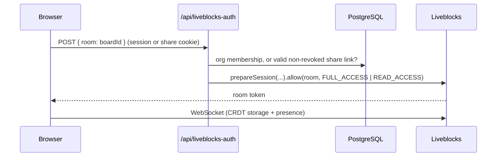

# Architecture

## Routes and UI structure

| Route                                            | Purpose                                                                                    |
| ------------------------------------------------ | ------------------------------------------------------------------------------------------ |
| `/`                                              | Public landing page. Shows "Open dashboard" instead of "Get started" to signed-in visitors |
| `/login`, `/register`, `/reset`, `/new-password` | Authentication screens (`app/(auth)`)                                                      |
| `/dashboard`                                     | Team dashboard: overview, all boards, favorites, search (`app/(dashboard)`)                |
| `/board/[boardId]`                               | The canvas editor (full-screen, outside the dashboard layout)                              |
| `/board-link/[token]`, `/invite/[token]`         | Share-link and email-invite entry points                                                   |

The dashboard view is driven by the query string (`?view=all`, `?favorites=true`, `?search=`), resolved in one place: `lib/dashboard-view.ts`. Design tokens (the indigo palette, surfaces, radius) live in `app/globals.css`; the site metadata, robots, sitemap, manifest and social card are generated from `lib/site.ts`.

## Access model

Every request is authorized in layers, so no single check is a single point of failure:

1. **`proxy.ts`** verifies the session JWT at the edge, redirects unauthenticated visitors to `/login` (keeping a `callbackUrl`), and bounces logged-in users away from auth pages. Public routes are matched by exact path segment, so `/board` is public but `/boardroom` is not.
2. **Server actions and pages** re-check the session and the caller's role themselves (`requireUser`, `requireOrgMember`, `requireOrgAdmin`). The proxy is a UX layer, not the security boundary.
3. **Liveblocks room access** is decided per request by `/api/liveblocks-auth`, which issues a `FULL_ACCESS` or `READ_ACCESS` room token based on org membership or a share link's own `canEdit` flag — this is the actual enforcement boundary for edit permissions, not the client UI (which only _hides_ editing controls for a read-only guest as a courtesy).

## Realtime authorization

Board content (the layer map and z-order list) lives in Liveblocks storage; users, teams, boards metadata, invites, and share links live in PostgreSQL. Share links set a per-board cookie, and guests get an anonymous `guest:<uuid>` identity.

## Data model

`User` ↔ `Membership` (role) ↔ `Organization` → `Board`. `Invite` (email + role + expiry) attaches a new user to an organization at registration. `BoardShareLink` (`canEdit`, expiry, revoked) grants anonymous access to one board. Verification and password-reset tokens are single-purpose, time-limited rows.
